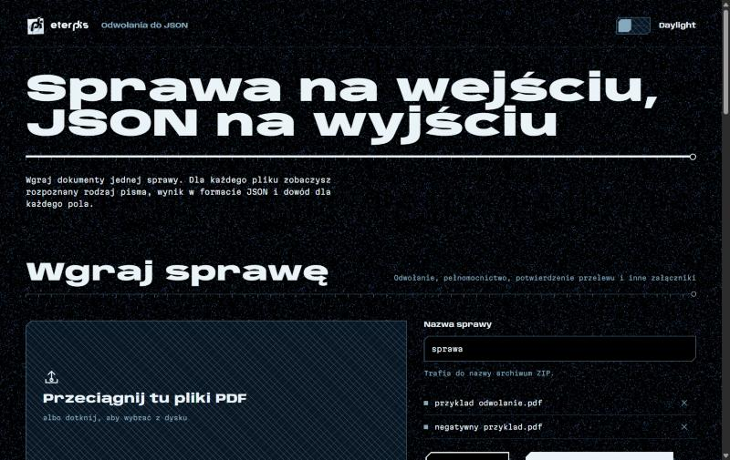
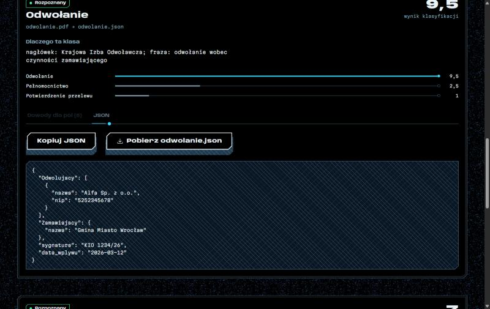
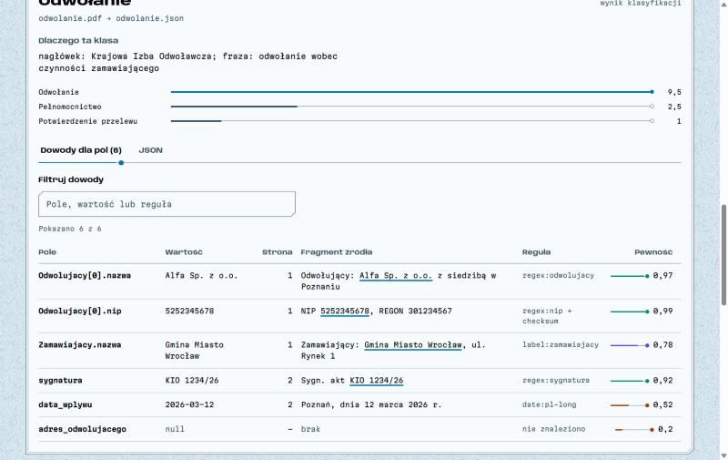
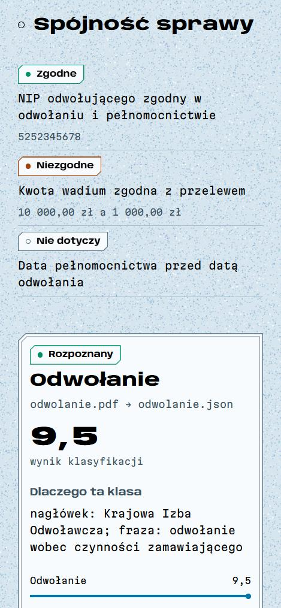

# odw2json: od dokumentów do danych

Zamienia sprawę odwoławczą KIO, czyli PDF-y odwołania, pełnomocnictwa i potwierdzenia przelewu, w pliki JSON zgodne
z modelem Urzędu Zamówień Publicznych. Rozpoznaje rodzaj dokumentu, odrzuca dokumenty spoza sprawy, wyciąga dane
i przy każdej wartości pokazuje dowód: stronę, fragment tekstu, regułę i pewność.

- **Bez chmury i bez LLM:** działa lokalnie na CPU, dane nie opuszczają komputera.
- **Skany też:** strony bez warstwy tekstowej czyta OCR (RapidOCR).
- **Nowy typ dokumentu = plik YAML,** bez programowania: [docs/ADDING_A_DOCUMENT_CLASS.md](docs/ADDING_A_DOCUMENT_CLASS.md).
- Projekt na HackNation 2026 (wyzwanie UZP „Odwołania2json”).

## Szybki start

Wejście: `input/<sprawa>/*.pdf`. Wyjście: `output/<sprawa>/<nazwa_pdf>.json` (dokument odrzucony nie dostaje pliku).

### Windows (Python 3.13)
```
start.bat            :: przetwarza .\input -> .\output (pierwsze uruchomienie instaluje zależności)
start.bat web        :: interfejs w przeglądarce: http://127.0.0.1:8000
```

### Docker
```
docker compose up --build              # interfejs: http://localhost:8000
docker compose run --rm cli            # .\input -> .\output
```

### Python (dowolny system)
```
python -m venv .venv && . .venv/bin/activate      # Windows: .venv\Scripts\activate
pip install -r requirements.txt
python -m odw2json --input input --output output  # --recipes <katalog> dla własnych receptur
python -m web --port 8000                         # interfejs webowy
```

## Co dostaje użytkownik
| Dokument | Plik wynikowy | Najważniejsze pola |
|---|---|---|
| Odwołanie do KIO | `odwolanie.json` | data i miejscowość, zaskarżona czynność (kod 1–11 i dzień), Odwołujący (nazwa, KRS, NIP, REGON, pełnomocnik), Zamawiający, numer BZP/TED, numer i tytuł postępowania |
| Pełnomocnictwo | `pelnomocnictwo.json` | mocodawcy (także konsorcjum), osoby podpisujące, pełnomocnicy |
| Potwierdzenie przelewu | `przelew.json` | kwota, data, rachunki, numer transakcji, tytuł |

Format i komplet pól: `schemas/*.json` (zgodne z `oczekiwane-json` UZP). Pole, którego nie ma w dokumencie, ma wartość `null`.

Interfejs webowy pozwala wgrać PDF-y sprawy i pokazuje klasę z punktacją, JSON oraz tabelę dowodów z pewnością
każdego pola. Wyniki można pobrać jako ZIP.

| | |
|---|---|
|  |  |
|  |  |

*Zrzuty z prototypu na danych przykładowych (mock); do podmiany na zrzuty z bieżącej wersji.*

## Jak mierzyliśmy jakość
Lokalny miernik `eval/score.py`: F1 na poziomie pól, dokładne porównanie wartości (opis miary w nagłówku pliku).
Strojenie na przykładach 01–40, kontrola na odłożonych 41–60 ze zbioru treningowego UZP:

| Typ | F1 (41–60) |
|---|---|
| odwołanie | *do uzupełnienia po scaleniu T005/T006* |
| pełnomocnictwo | *do uzupełnienia* |
| przelew | *do uzupełnienia* |

```
python -m eval.score --pred output --gold <katalog z wzorcowymi JSON> --cases 41-60 --report raport.md
```

## Dokumentacja
- [Architektura](docs/ARCHITECTURE.md): moduły, przepływ danych, decyzje, punkty rozszerzeń.
- [Dodawanie klasy dokumentu](docs/ADDING_A_DOCUMENT_CLASS.md): samouczek i pełny opis receptur.
- [Komponenty zewnętrzne i licencje](docs/EXTERNAL_COMPONENTS.md): wyłącznie licencje permisywne, bez AGPL/GPL.

## Licencja i dane
Dane konkursowe UZP nie są częścią repozytorium (licencja nieustalona). Pobiera się je osobno do `uzp-data/`, które
jest wykluczone z gita. Informacje dla zespołu: [TEAM.md](TEAM.md).
